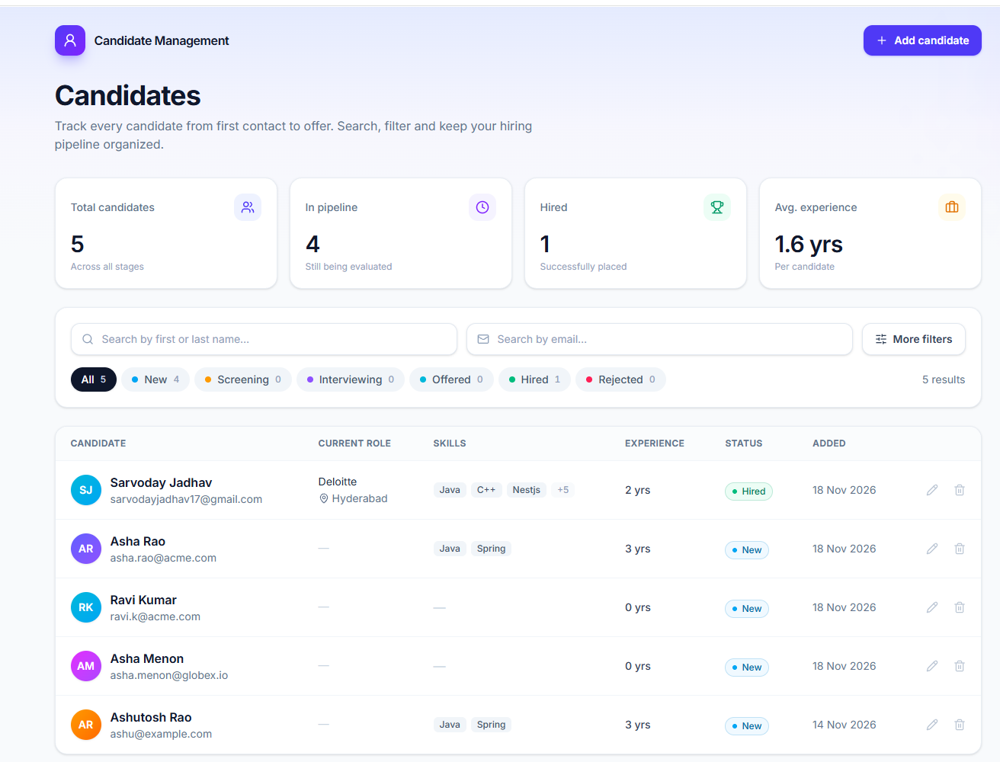
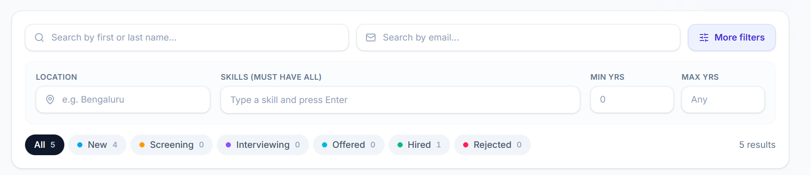
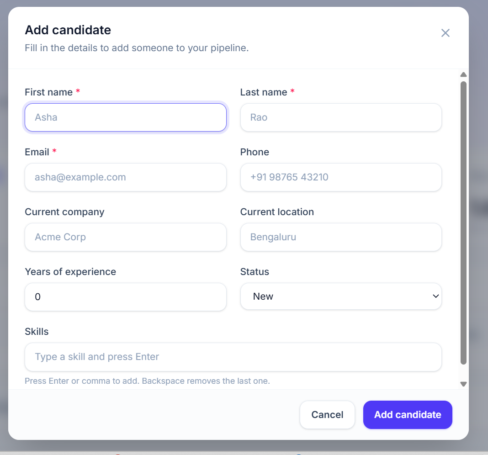
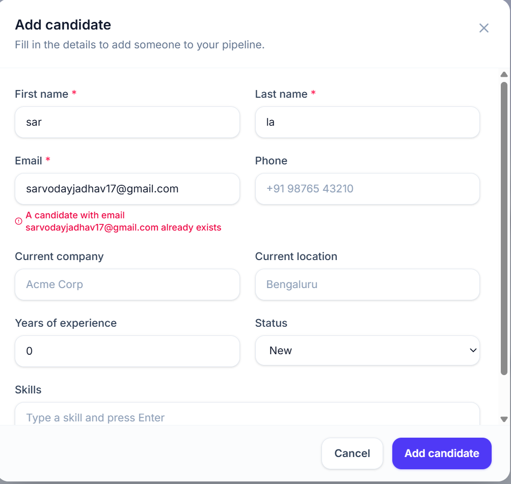
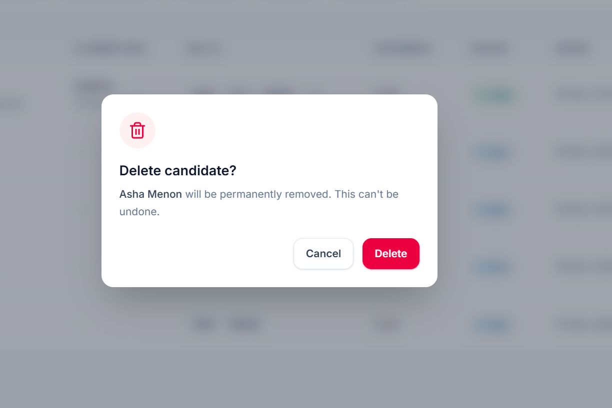

# Candidate Management System

A full-stack application for tracking candidates through a hiring pipeline. A **Spring Boot** REST API stores candidates in **PostgreSQL** (hosted on Neon), and a **React + Tailwind CSS** single-page app lets you add, search, filter, edit and delete them.

- Create, read, update and delete candidates
- Search by name and email; filter by location, skills, experience range and status
- Server-side pagination and a dashboard stats endpoint
- Database schema managed with **Prisma**, with indexes designed for the app's actual query patterns
- Responsive UI with loading, empty and error states

## Contents

- [Screenshots](#screenshots)
- [Tech stack](#tech-stack)
- [Architecture](#architecture)
- [Project structure](#project-structure)
- [Getting started](#getting-started)
- [Configuration](#configuration)
- [API reference](#api-reference)
- [Data model](#data-model)
- [Performance design](#performance-design)
- [Frontend](#frontend)
- [Testing](#testing)
- [Development workflow](#development-workflow)
- [Troubleshooting](#troubleshooting)
- [Known limitations](#known-limitations)
- [Technical design document](docs/technical-design.md)

## Screenshots

### Dashboard

Pipeline stats, search, status filters and the paginated candidate table.



### Search and filters

Name and email search, plus location, skills and experience filters. Results update as you type.



### Add a candidate

<table>
  <tr>
    <td width="50%">
      
      <p align="center"><sub>Add candidate form</sub></p>
    </td>
    <td width="50%">
      
      <p align="center"><sub>Inline validation and duplicate-email error</sub></p>
    </td>
  </tr>
</table>

### Delete confirmation

Deleting asks for confirmation first.



## Tech stack

| Layer | Technology |
|---|---|
| Backend | Java 21, Spring Boot 4.1 (Spring Web MVC, Spring Data JPA, Bean Validation, Spring Cache), Hibernate, Lombok |
| Database | PostgreSQL 18 on [Neon](https://neon.tech), extension `pg_trgm` |
| Schema tooling | Prisma 7 (schema and `db push` only; the running app uses Hibernate) |
| Cache | Caffeine (in-process) |
| Frontend | React 19, Vite 8, Tailwind CSS 4, lucide-react icons |
| Build | Maven (wrapper included), npm |

## Architecture

```
Browser (React SPA, :5173)
   │  /api/*   (Vite dev server proxies to the backend, so no CORS setup is needed in development)
   ▼
Spring Boot (:8080)
   Controller  ->  Service  ->  Repository  ->  Hibernate  ->  HikariCP pool  ->  Neon PostgreSQL
   (HTTP, DTOs)    (rules,      (Spring Data     (SQL           (10 connections)
                    transactions, JPA + Specs)    generation)
                    caching)
```

| Layer | Responsibility |
|---|---|
| `controller` | HTTP only: routes, status codes, request/response DTOs |
| `service` | Business rules, transactions, normalization, caching, duplicate-email handling |
| `repository` | Database access; dynamic filters are built as JPA Specifications |
| `model` | JPA entity mapped to the table Prisma creates |
| `dto` | Request, response, search-criteria, page and stats shapes; the entity is never exposed directly |
| `exception` | Domain exceptions mapped to RFC 7807 `ProblemDetail` responses in one place |

**Who owns what:** Prisma creates and changes the tables and indexes. Hibernate runs with `ddl-auto=validate`, so it only checks that the entity matches the database and never alters it.

## Project structure

```
Candidate-Management-System/
├── backend/
│   ├── pom.xml, mvnw, mvnw.cmd          Maven build and wrapper
│   ├── package.json, prisma.config.ts   Prisma tooling and scripts
│   ├── prisma/
│   │   ├── schema.prisma                Table, enum and index definitions
│   │   └── sql/                         One-off SQL: pg_trgm extension, data backfill
│   ├── src/main/
│   │   ├── java/com/candidatemgmt/
│   │   │   ├── config/                  CacheConfig
│   │   │   ├── controller/              CandidateController, HelloController
│   │   │   ├── dto/                     CandidateRequest/Response/SearchCriteria/Stats, PageResponse
│   │   │   ├── exception/               NotFound, DuplicateEmail, GlobalExceptionHandler
│   │   │   ├── model/                   Candidate, CandidateStatus
│   │   │   ├── repository/              CandidateRepository, CandidateSpecifications
│   │   │   └── service/                 CandidateService
│   │   └── resources/application.properties
│   └── src/test/
│       ├── java/com/candidatemgmt/      Unit, web-layer and integration tests
│       └── resources/schema.sql         Test database schema (generated from schema.prisma)
├── docs/screenshots/                    Images used in this README
└── frontend/
    ├── vite.config.js                   Dev server, /api proxy and test configuration
    └── src/
        ├── App.jsx                      State, data fetching, composition
        ├── components/                  FilterBar, CandidateTable, CandidateFormModal, Pagination, ...
        ├── lib/                         api client, constants, formatting, shared styles
        └── test/                        Test setup and an in-memory fake of the API (tests sit next to the code as *.test.js(x))
```

## Getting started

### Prerequisites

| Tool | Version | Notes |
|---|---|---|
| JDK | **21** (a full JDK, not a JRE) | `javac -version` must work. Maven fails with "No compiler is provided" on a JRE. |
| Node.js | 20.19 or newer | Developed on Node 26 |
| PostgreSQL | A database you can reach | These steps use a free [Neon](https://neon.tech) project |
| Git | any | |

Maven does not need to be installed; the wrapper (`mvnw`) downloads it.

### 1. Clone

```bash
git clone https://github.com/sarvoday71/Candidate-Management-System.git
cd Candidate-Management-System
```

### 2. Create the database

Create a Neon project and note its connection details (host, database, user, password). Neon gives two hostnames: the **pooled** one contains `-pooler`; the other is the **direct** one.

### 3. Add your credentials (two git-ignored files)

Credentials are never committed. Create both files yourself.

**`backend/src/main/resources/application-local.properties`**: used by the Spring Boot app (the pooled host is fine here):

```properties
spring.datasource.url=jdbc:postgresql://<host>:5432/<database>?sslmode=require
spring.datasource.username=<user>
spring.datasource.password=<password>
```

**`backend/.env`**: used only by Prisma commands (prefer the direct, non-pooler host for schema changes):

```env
DATABASE_URL="postgresql://<user>:<password>@<host>/<database>?sslmode=require"
```

### 4. Create the schema

```bash
cd backend
npm install
npm run db:extensions     # enables the pg_trgm extension (once per database)
npm run db:push           # creates the table, enum and indexes
npm run db:backfill       # normalizes pre-existing rows; harmless on an empty database
```

### 5. Run the backend

```bash
# still in backend/
./mvnw spring-boot:run          # macOS / Linux / Git Bash
.\mvnw.cmd spring-boot:run      # Windows PowerShell
```

Wait for `Started CandidateManagementApplication`. Check it:

```bash
curl http://localhost:8080/hello
curl http://localhost:8080/api/candidates
```

### 6. Run the frontend

In a second terminal:

```bash
cd frontend
npm install
npm run dev
```

Open **http://localhost:5173**. The dev server proxies `/api` to `http://localhost:8080`. To point it at a backend on another port: `API_TARGET=http://localhost:8081 npm run dev` (PowerShell: `$env:API_TARGET="http://localhost:8081"; npm run dev`).

## Configuration

All backend settings live in [`backend/src/main/resources/application.properties`](backend/src/main/resources/application.properties). Credentials come from the git-ignored `application-local.properties`, which is activated by `spring.profiles.active=local`.

| Property | Value | Why |
|---|---|---|
| `spring.jpa.hibernate.ddl-auto` | `validate` | Prisma owns the schema; Hibernate only verifies it |
| `spring.jpa.open-in-view` | `false` | Don't hold a DB connection for the whole HTTP request |
| `spring.jpa.show-sql` | `false` | Console logging on every query is slow. Turn it on for debugging with `SPRING_JPA_SHOW_SQL=true` |
| `spring.datasource.hikari.maximum-pool-size` | `10` | Connection pool size |
| `spring.datasource.hikari.connection-timeout` | `5000` | Fail fast under overload instead of waiting 30 s |
| `spring.datasource.hikari.idle-timeout` / `max-lifetime` | `300000` / `600000` | Recycle connections before Neon drops idle ones |
| `spring.threads.virtual.enabled` | `true` | Java 21 virtual threads for I/O-bound requests |
| `server.compression.enabled` | `true` | gzip for JSON responses over 1 KB |
| `spring.cache.caffeine.spec` | `maximumSize=10,expireAfterWrite=30s` | Dashboard stats cache |

Spring Boot reads any property from an environment variable (`server.port` becomes `SERVER_PORT`), which is the simplest way to override one for a single run in either shell:

```bash
# macOS / Linux / Git Bash
SERVER_PORT=8081 SPRING_JPA_SHOW_SQL=true ./mvnw spring-boot:run
```

```powershell
# Windows PowerShell
$env:SERVER_PORT = "8081"; $env:SPRING_JPA_SHOW_SQL = "true"; .\mvnw.cmd spring-boot:run
```

## API reference

Base URL: `http://localhost:8080/api/candidates`. All bodies are JSON.

| Method | Path | Description | Success |
|---|---|---|---|
| `POST` | `/api/candidates` | Create a candidate | `201` + body + `Location` header |
| `GET` | `/api/candidates` | Search, filter and paginate | `200` page object |
| `GET` | `/api/candidates/{id}` | Get one candidate | `200` |
| `PUT` | `/api/candidates/{id}` | Replace a candidate's fields | `200` |
| `DELETE` | `/api/candidates/{id}` | Delete a candidate | `204` |
| `GET` | `/api/candidates/stats` | Dashboard counts | `200` |
| `GET` | `/hello` | Liveness check | `200` text |

### The candidate object

```json
{
  "id": 14,
  "firstName": "Asha",
  "lastName": "Rao",
  "email": "asha.rao@acme.com",
  "phone": "+91 98765 43210",
  "skills": ["Java", "Spring"],
  "experienceYears": 3,
  "currentCompany": "Acme Corp",
  "currentLocation": "Bengaluru",
  "status": "NEW",
  "createdAt": "2026-11-14T11:39:45.376892",
  "updatedAt": "2026-11-14T11:39:45.377"
}
```

Timestamps are UTC with no zone suffix. `status` is one of `NEW`, `SCREENING`, `INTERVIEWING`, `OFFERED`, `HIRED`, `REJECTED`.

### Create and update

`POST` and `PUT` accept the same body:

| Field | Required | Rules |
|---|---|---|
| `firstName`, `lastName` | yes | non-blank |
| `email` | yes | valid email, unique (case-insensitive) |
| `phone`, `currentCompany`, `currentLocation` | no | free text |
| `skills` | no | list of strings (default `[]`) |
| `experienceYears` | no | integer ≥ 0 (default `0`) |
| `status` | no | one of the statuses above (default `NEW`) |

```bash
curl -X POST http://localhost:8080/api/candidates \
  -H "Content-Type: application/json" \
  -d '{"firstName":"Asha","lastName":"Rao","email":"asha.rao@acme.com","skills":["Java","Spring"],"experienceYears":3}'
```

In Windows PowerShell, `Invoke-RestMethod` avoids quoting problems:

```powershell
Invoke-RestMethod -Method Post -Uri http://localhost:8080/api/candidates -ContentType "application/json" `
  -Body '{"firstName":"Asha","lastName":"Rao","email":"asha.rao@acme.com","skills":["Java","Spring"],"experienceYears":3}'
```

The server normalizes input before saving: the email is lowercased, and skills are trimmed and de-duplicated case-insensitively (the first spelling is kept for display).

### Search, filter and pagination

All parameters are optional and combine with **AND**.

| Parameter | Behavior |
|---|---|
| `name` | Every word must appear in the first or last name (partial, case-insensitive). `name=rao asha` matches "Asha Rao". |
| `email` | Partial, case-insensitive |
| `location` | Partial, case-insensitive match on current location |
| `skills` | The candidate must have **all** listed skills, matched as whole skills and case-insensitively (`java` does not match "JavaScript"). Comma-separated (`skills=java,spring`) or repeated (`skills=java&skills=docker`). |
| `minExperience`, `maxExperience` | Inclusive bounds on `experienceYears` |
| `status` | Exact match, **uppercase** (`HIRED`) |
| `page` | Zero-based page number (default `0`; negative values are treated as `0`) |
| `size` | Page size (default `20`; clamped to `1`-`100`) |

Results are ordered newest first (`id` descending). Blank values are ignored, and `%` and `_` in search text are treated literally.

```bash
curl "http://localhost:8080/api/candidates?location=bengal&skills=java&maxExperience=5&status=NEW&page=0&size=20"
```

Response:

```json
{
  "content": [ { "id": 14, "firstName": "Asha", "...": "..." } ],
  "page": 0,
  "size": 20,
  "totalElements": 1,
  "totalPages": 1
}
```

### Stats

`GET /api/candidates/stats` runs one aggregate query. The result is cached for 30 seconds and the cache is cleared on every create, update or delete.

```json
{
  "total": 5,
  "averageExperience": 1.6,
  "byStatus": { "NEW": 5, "SCREENING": 0, "INTERVIEWING": 0, "OFFERED": 0, "HIRED": 0, "REJECTED": 0 }
}
```

### Errors

Errors use the RFC 7807 problem format:

| Status | When |
|---|---|
| `400` | Validation failed, bad enum value (such as `status=hired`), or a non-numeric number |
| `404` | No candidate with that id |
| `409` | The email already belongs to another candidate |

```json
{ "status": 400, "detail": "Validation failed", "errors": { "email": "must be a well-formed email address" } }
```

## Data model

Table `candidate` (defined in [`schema.prisma`](backend/prisma/schema.prisma)):

| Column | Type | Notes |
|---|---|---|
| `id` | serial, primary key | |
| `first_name`, `last_name` | text, required | |
| `email` | text, required, **unique** | Always stored lowercase |
| `phone` | text, optional | |
| `skills` | text[] | Original casing, for display |
| `skills_search` | text[] | Lowercased copy of `skills`, maintained by the app; only used for filtering |
| `experience_years` | int, default 0 | |
| `current_company`, `current_location` | text, optional | |
| `status` | enum `CandidateStatus`, default `NEW` | Native Postgres enum |
| `created_at`, `updated_at` | timestamp | UTC |

### Indexes

| Index | Serves |
|---|---|
| `candidate_email_key` (unique, btree) | Uniqueness and exact email lookups |
| `candidate_first_name_trgm_idx`, `candidate_last_name_trgm_idx` (GIN, `gin_trgm_ops`) | `name` search |
| `candidate_email_trgm_idx` (GIN, `gin_trgm_ops`) | `email` search |
| `candidate_location_trgm_idx` (GIN, `gin_trgm_ops`) | `location` filter |
| `candidate_skills_search_gin_idx` (GIN) | `skills` filter (`@>` array containment) |
| `candidate_status_experience_idx` (btree on `status`, `experience_years`) | `status` and experience filters; lets the stats query use an index-only scan |
| `candidate_experience_idx` (btree on `experience_years`) | Experience range on its own |

## Performance design

Problems found in the first version, and what was done about each:

| Problem | Fix |
|---|---|
| `GET /api/candidates` returned every row | Server-side pagination (default 20, max 100), newest first |
| Text search was `LIKE '%x%'` on `lower(column)`, which a btree can't serve, so every search scanned the table | `ILIKE` on the raw column with trigram GIN indexes |
| Skills filter built a string with `array_to_string` and ran `LIKE` on it | Lowercased `skills_search` column with a GIN index and array containment (`@>`) |
| Duplicate-email check was `lower(email) = ?`, a table scan, and had a check-then-insert race that could surface as a 500 | Email stored lowercase; the unique index is the single source of truth. A conflict becomes a 409, including under concurrent requests |
| Frontend downloaded the entire table to compute dashboard numbers | `/stats` endpoint with one aggregate query and a 30-second cache that is cleared on writes |
| Create and delete each took 2 database round trips (expensive against a remote database) | Create: one insert. Delete: one `DELETE` statement. |
| Open-session-in-view, no pool timeouts, SQL logged to the console on every query, no compression | Turned off / tuned / enabled (see [Configuration](#configuration)) |

### Measured results

100,000 synthetic rows on Neon, `EXPLAIN ANALYZE` execution time, best of three. "Before" is the previous schema with the old query shape. "After" is the indexed schema with the new, paged query.

| Query | Before | After |
|---|---|---|
| Name search (about 5% of rows) | 17.2 ms (seq scan) | 0.2 ms (index) |
| Name search, two words | 23.1 ms | 2.3 ms |
| Email contains | 16.5 ms | 0.3 ms |
| Location contains | 15.1 ms | 0.1 ms |
| Skills: java + spring | 45.4 ms | 0.2 ms |
| Status + experience range | 8.5 ms | 0.2 ms |
| `COUNT(*)` for pagination, name / skills | 16.6 / 45.3 ms | 3.7 / 2.6 ms |
| Duplicate-email check | 12.7 ms | under 0.1 ms |
| Dashboard stats | 9.8 ms | 13.4 ms |

How to read these numbers:

- They are **database-side times**. From a laptop, the network round trip to a remote database is far larger than these queries, so the gain shows up as database capacity under concurrent load, not as faster single requests.
- The "after" list queries stop early after 20 rows. The `COUNT(*)` rows are the fairer measure of full-match cost.
- The stats aggregate is **not** faster at this size. Its benefit is that the browser no longer downloads the whole table, plus the cache.
- Indexes cost storage and write speed. On the benchmark table, index size went from about 9 MB to 20 MB. Write slowdown was not measured.

## Frontend

A Vite + React single-page app in `frontend/`.

- **Dashboard cards:** total, in pipeline, hired, average experience (from `/stats`)
- **Search and filters:** name and email search up front; a "More filters" panel for location, skills (type and press Enter), and min/max experience; status chips with live counts. Typing is debounced (300 ms) and filter changes return to page 1.
- **Table:** avatar initials, skills preview, colour-coded status badges, hover actions. It becomes stacked cards on small screens.
- **Add/edit modal:** client-side validation, server errors shown on the field (for example a duplicate email), Esc to close
- **Delete confirmation**, toast notifications, loading skeletons, empty and error states with retry

Production build: `npm run build` outputs static files to `frontend/dist`. In production the app must be served from the same origin as the API (or the backend needs CORS configured), because the `/api` proxy exists only in the dev server.

## Testing

| Suite | Command | Tests |
|---|---|---|
| Backend (JUnit 5, Mockito, MockMvc) | `cd backend && ./mvnw test` | 129 |
| Frontend (Vitest, Testing Library) | `cd frontend && npm test` | 108 |

### Backend

| Kind | What it covers |
|---|---|
| **Unit** (`CandidateServiceTest`) | Defaults, name and skill cleanup, duplicate-email mapping, paging limits and sort order, stats arithmetic, not-found handling. The repository is mocked. |
| **Web layer** (`CandidateControllerTest`) | Routes, request validation, binding of every query parameter, status codes and error bodies. The service is mocked. |
| **Integration** (`CandidateCrudIntegrationTest`, `CandidateSearchIntegrationTest`, `CandidateStatsIntegrationTest`) | The real application against a real PostgreSQL: create, read, update and delete, email normalization, duplicate emails (including 10 simultaneous creates), every filter and combination of filters, pagination, and the stats cache (hit, and eviction on create, update and delete). |
| **Schema guard** (`CandidateSchemaIntegrationTest`) | The indexes exist, and the query shapes the filters generate are ones PostgreSQL can answer from them. It would fail if a filter were rewritten into a form that can no longer use an index. |

How the integration tests work:

- They start an **embedded PostgreSQL 18.7** (the same version as the production database) using [zonky embedded-postgres](https://github.com/zonkyio/embedded-postgres). **No Docker and no network database are needed**, and the tests never connect to Neon.
- H2 is deliberately not used: the filters rely on PostgreSQL-only features (`ILIKE`, `text[]`, native enums).
- The test schema, `backend/src/test/resources/schema.sql`, is **generated from `schema.prisma`**, so it cannot drift from production. After changing `schema.prisma`, regenerate it with `npm run db:test-schema` (in `backend/`).
- Every run starts a fresh database in your temp folder, which adds about 30 seconds on a typical laptop; the very first run also downloads the PostgreSQL binaries once. It runs as your normal user and cannot run as Administrator or root.
- The database and test data live only for the duration of the test run.

### Frontend

Tests run in a simulated browser (jsdom) with no network. `fetch` is mocked, and the App tests use a small in-memory fake of the backend (`src/test/mockApi.js`).

| Area | What it covers |
|---|---|
| API client | URL and query building (repeated `skills`, blank values omitted, paging), request shapes, error mapping, network failure |
| Helpers | Date, initials and pluralization formatting |
| Components | Tag input, pagination (range text, disabled edges, ellipsis windowing), filters (patches, status chips, clear), the add/edit form (validation, exact payload, server errors) |
| App | Initial load, debounced search, paging, filters resetting to page 1, empty and error states, delete flow |

These are not browser end-to-end tests, so real layout and styling are not covered by them.

## Development workflow

### Commands

| Where | Command | Purpose |
|---|---|---|
| `backend/` | `./mvnw spring-boot:run` | Start the API on :8080 |
| `backend/` | `./mvnw test` | Run the backend tests (embedded PostgreSQL, see [Testing](#testing)) |
| `backend/` | `npm run db:test-schema` | Regenerate the test database schema from `schema.prisma` |
| `backend/` | `npm run db:validate` | Validate `schema.prisma` |
| `backend/` | `npm run db:extensions` | Enable `pg_trgm` |
| `backend/` | `npm run db:push` | Apply schema changes to the database |
| `backend/` | `npm run db:backfill` | Normalize existing rows (email lowercase, `skills_search`) |
| `backend/` | `npm run db:studio` | Open Prisma Studio to browse data |
| `frontend/` | `npm run dev` | Dev server on :5173 |
| `frontend/` | `npm test` / `npm run test:watch` | Run the frontend tests once / in watch mode |
| `frontend/` | `npm run build` / `npm run preview` | Production build / serve it locally |

### Changing the schema

1. Edit `backend/prisma/schema.prisma`.
2. Preview the SQL without applying it:
   `npx prisma migrate diff --from-config-datasource --to-schema prisma/schema.prisma --script`
3. Apply with `npm run db:push`.
4. Update the JPA entity in `model/Candidate.java` to match. Startup fails with `ddl-auto=validate` if they disagree.

### Rules the application maintains

Two columns are normalized **by the application**, not the database: `email` is stored lowercase and `skills_search` mirrors `skills` in lowercase. Anything that writes to the table directly (SQL scripts, Prisma Studio, imports) must follow the same rules, or searches and the unique-email guarantee will be off. `npm run db:backfill` repairs existing rows.

### Looking at the SQL

Run with `SPRING_JPA_SHOW_SQL=true` (see [Configuration](#configuration)) and every statement Hibernate generates is printed. Filters should produce queries such as:

```sql
... where email ilike ? escape '\' and skills_search @> cast(? as text[]) order by id desc offset ? rows fetch first ? rows only
```

## Troubleshooting

| Symptom | Cause and fix |
|---|---|
| `No compiler is provided in this environment. Perhaps you are running on a JRE rather than a JDK?` | Maven is using a JRE (often an old Java 8 earlier on `PATH`). Install JDK 21 and point `JAVA_HOME` at it. It only appears when Maven has to recompile, so it can seem intermittent. |
| `Failed to delete ...\target\classes` on `mvnw clean` | Your IDE's Java tooling holds files open (OneDrive syncing can add to it). Close the IDE or skip `clean`; a normal run doesn't need it. |
| App fails at startup with a schema validation error | The database doesn't match the entity. Run `npm run db:push` in `backend/` (and `npm run db:extensions` first on a new database). |
| Prisma: `P1001 Can't reach database server` | Neon may be waking from idle; retry. Prisma's engine has a short connect timeout. Also check your network or VPN. |
| `Port 8080 was already in use` | Another instance is running. Stop it or set `SERVER_PORT=8081` (and `API_TARGET` for the frontend). |
| Frontend shows "Cannot reach the server" | The backend isn't running, or `API_TARGET` points at the wrong port. |
| `status=hired` returns 400 | Status values are uppercase. |
| Backend tests fail while starting PostgreSQL | The embedded database needs a writable temp folder, permission to run the extracted `postgres` binary (some security software blocks it), and a normal non-admin user. |
| Creating a candidate returns 409 | That email already exists. Emails are compared case-insensitively. |

## Known limitations

- **No authentication or authorization.** Anyone who can reach the API can read and change data. There is also no rate limiting.
- **Tests:** there are no browser end-to-end tests (the frontend is tested in a simulated browser), no load tests, and no CI workflow yet to run the suites on every push.
- **Schema management** uses `prisma db push` and has no migration history. For a production workflow, baseline the database and move to `prisma migrate`.
- **Deep pagination** uses offset paging, so very high page numbers get slower. Cursor-style paging would fix that.
- **Stats** are a single aggregate that still reads every row (index-only). At very large sizes, maintained counters or a materialized view would be the next step.
- **Name search matches words**, not full-text relevance: there is no ranking, stemming or fuzzy matching.
- **Deployment:** no Dockerfile or CI configuration yet, and the frontend relies on the dev-server proxy.
- **License:** none has been chosen yet.
